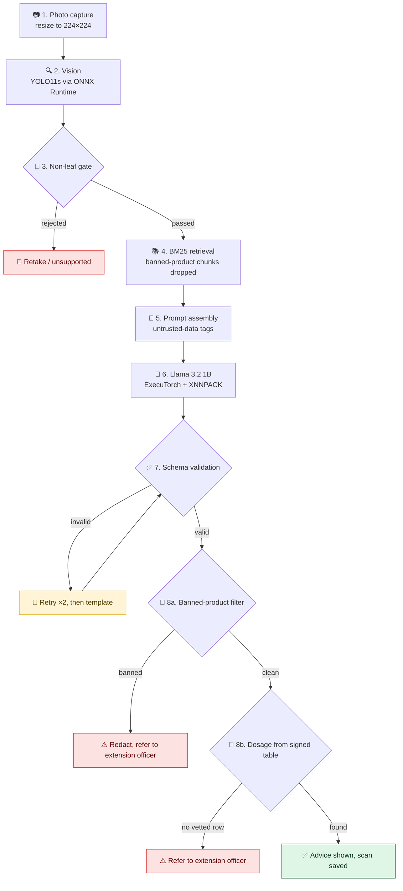

<div align="center">


# 🌿 Green Clinic

### An offline-first crop healthcare system, running entirely on your phone.

*Detect crop diseases and insect pests, then get safe, grounded treatment advice with **no internet connection**, no server and no cloud.**

<br/>


[**📄 Read the paper**](docs/AgriEdge_paper.pdf) · [**🏗️ Architecture**](#️-architecture) · [**🛡️ Safety pipeline**](#️-the-fail-closed-safety-pipeline) · [**📊 Results**](#-vision-model-results)

</div>

---

## 📖 Overview

Smallholder farmers in connectivity-poor regions often can't reach an agronomist, and cloud-based AI tools stop working the moment the signal drops. **Green Clinic** brings both a vision model and a language model onto an ordinary Android phone, so a farmer can photograph a leaf or an insect, get a diagnosis, and ask follow-up questions, all in the field.

Language models can invent dosages or recommend banned chemicals, which is a real hazard to people and the environment. So Green Clinic never lets the language model decide anything safety-critical: it only writes explanatory text, while every answer is checked by deterministic code, and dosage numbers come from a **cryptographically signed lookup table**.

> **Project codename:** `AgriEdge` (you'll see it in the native plugin name, `AgriEdgeEngine`, and in the UI's *Ask AgriEdge* screen).

---

## ✨ Highlights

| | Feature | Details |
|---|---|---|
| 📴 | **Fully offline** | After install, no network is ever required |
| 🔍 | **228-label vision classifier** | Plant diseases, cassava diseases and insect pests in one model |
| 💬 | **On-device chat** | Llama 3.2 1B Instruct, 4-bit quantized, answers follow-up questions |
| 🛡️ | **Fail-closed safety** | Schema validation, banned-pesticide filter, signed dosage tables |
| 📚 | **Grounded answers** | In-memory, Devanagari-aware BM25 retrieval, with no vector DB needed |
| 🔊 | **Speech output** | Android TextToSpeech reads advice aloud |
| 🔐 | **Local accounts** | PBKDF2-SHA256 hashed passwords, scan history stored on the device |
| 🌐 | **Multilingual UI** | Language switcher built into the app |

---

## 📱 The App

<div align="center">


*Scan a leaf → see the diagnosis and confidence → tap **Get advice**.*

</div>

The app has five tabs: **Home**, **Scan Leaf**, **Ask**, **History** and **Account**.

---

## 🏗️ Architecture

Green Clinic is a layered, server-less system. A **React UI** talks to a **TypeScript engine** inside a Capacitor WebView, and the engine reaches native runtimes through a single **Java plugin**.

<div align="center">


</div>

| Layer | Technology | Responsibility |
|---|---|---|
| **UI** | React in a hardened Capacitor WebView | Screens, camera capture, chat |
| **Engine** | TypeScript | Orchestration, retrieval, validation, signature checks, local auth, storage |
| **Native bridge** | Java plugin `AgriEdgeEngine` | Image detection, text generation, speech output, asset reading, health report |
| **Vision runtime** | ONNX Runtime Android | Runs the YOLO11s classifier |
| **LLM runtime** | ExecuTorch Android (XNNPACK) | Runs the quantized Llama 3.2 1B model |
| **Speech** | Android TextToSpeech | Reads advice aloud |

The WebView runs without `eval` privileges, so the engine uses **hand-written validators** instead of a runtime JSON-schema compiler.

### 💾 Data & storage

<div align="center">


</div>

| Storage | Contents | Used by |
|---|---|---|
| **SQLite** | `users`, `scans` and `meta` tables; newest 500 scans per user; 30-day session pointer | Local auth and scan history |
| **Private files** | `llama32_1b_int4.pte`, `tokenizer.model` | ExecuTorch |
| **APK assets** | `chunks.jsonl`, `vision.onnx`, `labels.json`, signed `banned_pesticides.json` and `dosage_table.json` | BM25 retriever, Ed25519 verifier, ONNX Runtime |

---

## 🔄 How a diagnosis works

Every request flows through eight stages. The ones that can reject or redirect are **fail-closed**: when in doubt, the app refuses rather than guesses.



<details>
<summary><b>🔎 Stage-by-stage details</b></summary>

<br/>

1. **Capture & preprocessing:** the photo goes to the plugin as Base64, decoded and resized to 224×224.
2. **Vision inference:** ONNX Runtime returns logits over 228 labels, softmax gives probabilities, and the top label is the diagnosis. All models found in the model folder are run, and the other models' answers stay visible so wrong answers don't hide.
3. **Non-leaf gate:** the result is rejected when top probability is below **0.40**, or when plant-coloured pixels (green and yellow-brown) make up less than **1%** of the image, or less than **4%** unless top probability exceeds **0.90**.
4. **Retrieval:** the diagnosis queries `chunks.jsonl` through an in-memory, Devanagari-aware BM25 index. Chunks mentioning a banned product are dropped before prompting.
5. **Prompt assembly:** Llama 3 chat format. Retrieved text and user text are wrapped in tags marking them as untrusted data, which reduces prompt-injection impact.
6. **Generation:** ExecuTorch runs the quantized model until an end-of-turn token or the token limit.
7. **Validation:** output is checked against the `advisory_v3` schema. On failure, up to two retries, then a pre-written template for the diagnosed label.
8. **Safety checks:** text is Unicode-normalized (NFC) and matched against the banned-product list and its aliases. If clean, dosage is computed from the signed table.

</details>

---

## 🛡️ The fail-closed safety pipeline

The core design rule: **reasoning is separated from calculation.** The language model explains; deterministic code decides.

| Guard | What it does |
|---|---|
| 🚧 **Non-leaf gate** | Rejects blurry, low-confidence or non-plant photos before any advice is generated |
| 🧱 **Prompt-injection hardening** | Retrieved and user text is wrapped as untrusted data |
| 📋 **Schema validator** | Every answer must match `advisory_v3`; invalid output triggers retries, then a safe template |
| 🚫 **Banned-pesticide filter** | Unicode-normalized matching against the banned list and its aliases; matches are removed and the farmer is referred to an extension officer |
| 🔏 **Ed25519-signed tables** | The banned list and dosage table are signature-verified at start-up against a bundled public key. If verification fails, the engine **refuses to give chemical advice** |
| 🧮 **Calculated dosage** | Dosage figures never come from the LLM. They are computed as below |

```
Dose_total = A × R_vetted
```

where **A** is the parcel area entered by the farmer and **R** is the vetted rate from the signed table. If no vetted entry exists, the app refers the farmer to an extension officer.

---

## 👁️ Vision model

A single **YOLO11s-cls** classifier covers **228 labels** across four data groups:

| Source group | Classes |
|---|---:|
| PlantVillage subset (pepper, potato, tomato) | 15 |
| Additional plant-disease datasets (e.g. PlantDoc, PlantWild) | 105 |
| Cassava leaf disease | 5 |
| IP102 insect pests | 102 |

Trained on an NVIDIA RTX 4050 in about 2 h 51 min (10,281 s) with RandAugment and random erasing, early-stopped at epoch 57.

### 📊 Vision model results

Evaluated on a held-out split of **27,745 images**:

| Metric | Score |
|---|---:|
| **Top-1 accuracy** | **73.95%** |
| Macro recall | 65.6% |
| Macro precision | 61.8% |
| **Macro-F1** | **62.4%** |
| Weighted F1 | 73.7% |
| Validation top-5 accuracy | 93.78% |

**Performance by source group**

| Group | Images | Accuracy | Macro recall |
|---|---:|---:|---:|
| PlantVillage subset | 1,444 | 96.2% | 95.3% |
| Cassava | 2,439 | 84.5% | 74.6% |
| Additional plant diseases | 1,045 | 71.3% | 62.8% |
| IP102 insect pests | 22,619 | 71.6% | 63.7% |

**Takeaway:** plant-disease classes with enough examples are recognized well. Insect pests and low-support classes are the weak spot, with 41 labels at recall ≥ 0.90 but 51 below 0.50. The generic *aphids* class tends to attract look-alike insects, and *Cassava Bacterial Blight* is often mistaken for *Healthy* leaves.

---

## 🧠 On-device language model

| Setting | Value |
|---|---|
| Base model | Llama 3.2 1B Instruct |
| Quantization | **8da4w**: 4-bit weights (group 128), 8-bit dynamic activations |
| Embedding table | 4-bit, group size 32 |
| Backend | ExecuTorch with XNNPACK |
| Context window | 2048 tokens (KV cache on), shared by prompt and answer |
| Model file | ≈ 750 MB (`.pte`) |
| App size | ≈ 0.9 GB with the model bundled |
| Target | `arm64-v8a`, Android 11+ |

**Token budget:** the 2048 tokens are split across the chat template (~15), system instructions (150–300), retrieved chunks (500–1000), question and history (20–100) and the generated answer (300–600).

> 💡 The ExecuTorch memory planner reported about 2.07 GB of activation memory during export, so **a device with at least 6 GB of RAM is recommended**.

---

## 🧰 Tech stack

| Area | Tools |
|---|---|
| **Frontend** | React, Capacitor WebView |
| **Engine** | TypeScript (orchestrator, validators, BM25, rules, dosage tool, local auth) |
| **Native** | Java (JNI), Android TextToSpeech |
| **Vision** | YOLO11s-cls → ONNX → ONNX Runtime Android 1.20.0 |
| **LLM** | Llama 3.2 1B Instruct → ExecuTorch 1.1.0 (XNNPACK) |
| **Retrieval** | In-memory BM25 (Devanagari-aware) |
| **Crypto** | Ed25519 signature verification, PBKDF2-SHA256 (210,000 iterations, per-user salt) |
| **Storage** | SQLite |
| **CI / Build** | GitHub Actions, R8 shrinking in release builds |

---

## 🚧 Project status & honest limitations

Green Clinic is a **working application**, and the complete app including the quantized language model has been run on a physical Android phone. As a research prototype, it comes with clearly stated caveats:

- 🌾 **No independent field test yet.** The test split comes from the same pools as the training data, so reported accuracy likely overstates real-world performance, especially for lab-style plant-disease images.
- ⚖️ **Class imbalance & label noise.** 64 labels have fewer than ten test images, 8 have zero recall, and one stray label (`images`) comes from a folder name and is slated for removal.
- 🧪 **Language model not yet formally evaluated.** No agronomist has rated the answers, and adversarial safety tests with the real model are still to come.
- 📦 **Placeholder knowledge data.** The knowledge pack, banned list and dosage table are development placeholders and must be replaced with agronomist-vetted data (for example, from CIB&RC notifications) **before field use**. Advice is currently limited to tomato.
- 📏 **Dosage needs severity.** A classifier can't estimate severity, so a segmentation model is needed for full dosage calculation.
- 🗣️ **Languages & voice.** Llama 3.2 doesn't officially support Marathi or Telugu, so answers in those languages may be weak. Speech output depends on installed voices, and speech input isn't implemented yet.

### 🗺️ Roadmap

- [ ] Field-photo evaluation and a dedicated `test_field` split
- [ ] Cleaner label set, then retraining
- [ ] Agronomist-vetted knowledge pack, banned list and dosage tables
- [ ] Systematic on-device latency, memory, thermal and battery profiling
- [ ] Adversarial safety evaluation with the real language model
- [ ] Segmentation model for severity-aware dosage
- [ ] Speech input and better regional-language support

---

## 📄 Paper

This project is described in:

> **The Green Clinic: An Offline-First Crop Healthcare System for Disease Detection, Pest Identification, and Organic and Chemical Treatment Recommendations**
> Shrey Navnath Galgale, Parth Anil Patil, Samiksha Sachin Wake, Sadhana Babaso Koravi
> Dept. of Artificial Intelligence and Data Science, SITCOE, Yadrav, Ichalkaranji, India

📥 [Download the full paper (PDF)](docs/AgriEdge_paper.pdf)

<details>
<summary><b>📎 BibTeX</b></summary>

```bibtex
@article{galgale2026greenclinic,
  title  = {The Green Clinic: An Offline-First Crop Healthcare System for Disease
            Detection, Pest Identification, and Organic and Chemical Treatment
            Recommendations},
  author = {Galgale, Shrey Navnath and Patil, Parth Anil and
            Wake, Samiksha Sachin and Koravi, Sadhana Babaso},
  year   = {2026}
}
```

</details>

---

## ⚖️ Licensing notes

Please review the licences of the components this project builds on before distributing:

- **Llama 3.2**, under the Llama 3.2 Community License
- **Ultralytics YOLO11**, under AGPL-3.0
- **IP102, PlantVillage, PlantDoc, PlantWild, iCassava**, each under its own dataset terms

---

## 👥 Team

<div align="center">

| Shrey Navnath Galgale | Parth Anil Patil | Samiksha Sachin Wake | Sadhana Babaso Koravi |
|:---:|:---:|:---:|:---:|
| [galgaleshrey@gmail.com](mailto:galgaleshrey@gmail.com) | [parthpatil205455@gmail.com](mailto:parthpatil205455@gmail.com) | [samikshawake22@gmail.com](mailto:samikshawake22@gmail.com) | [Sadhanakoravi022@gmail.com](mailto:Sadhanakoravi022@gmail.com) |

**Department of Artificial Intelligence and Data Science**
SITCOE, Yadrav, Ichalkaranji, India

</div>

---

<div align="center">

*Built for the farmers who are far from the network, and far from the nearest agronomist.* 🌱

</div>