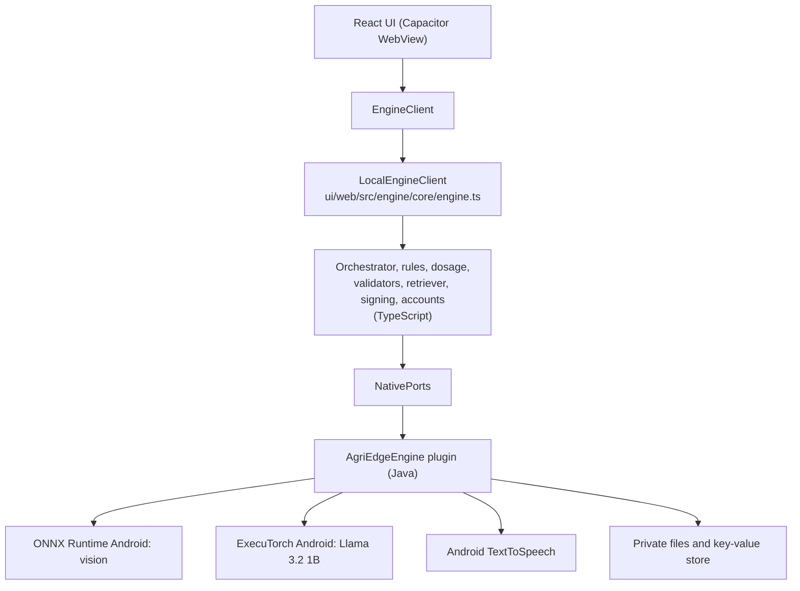

# Android app (APK)

Goal: the whole product runs on the phone with no server and no internet after setup. Vision, language model, rules, dosage, retrieval, login and speech all live inside the app. Status: the TypeScript engine is done and tested. The native plugin is written (Java, `ui/android/native/AgriEdgeEnginePlugin.java`) and compiles against API stubs only, because the Android SDK is not available in the authoring sandbox. The first real build and run on a phone are still to do.

## 1. Layers



The web UI talks to an `EngineClient` (`ui/web/src/contracts/types.ts`). On Capacitor, `index.ts` selects `NativeEngineClient`, which is `LocalEngineClient` wired to the plugin. In a browser it selects the dev engine (`web.ts`): ONNX models run in the page and the language model is not available, so the Ask tab and follow-up questions report that. Setting `VITE_ENGINE=native` forces the phone engine.

## 2. What is in TypeScript (done)

Under `ui/web/src/engine/core/`:

| File | Role |
|---|---|
| `engine.ts` | `LocalEngineClient`: login, photo analysis, advice, speech, health; fails closed if assets are missing or untrusted |
| `orchestrator.ts` | Same flow as `core/orchestrator.py`: refuse, retake, unsupported, healthy template, retrieve, generate, validate, retry up to 2, fallback, rule check, dosage |
| `validate.ts` | Hand-written validators for `advisory_v3` and `vision_result` (no runtime JSON-schema engine, because the CSP forbids eval); tests compare them with Ajv on the shared schemas |
| `rules.ts` | Banned-product matching after Unicode normalisation |
| `tools.ts` | Dosage table and `calcDosage`; totals come from the table only |
| `prompts.ts`, `templates.ts` | Prompt builder with untrusted-data tags; en, hi and mr templates (generated from the Python text) |
| `severity.ts` | Detection to vision result; severity stays empty without polygons |
| `retriever.ts` | In-memory BM25 over `knowledge/chunks.jsonl`, Devanagari aware |
| `signing.ts` | Ed25519 verification of signed JSON (`@noble/curves`), PEM key parsing |
| `localAuth.ts` | PBKDF2-SHA256 password hashing (210,000 iterations), lockout after 5 failures for 30 seconds |
| `types.ts` | Port and data types |

Accounts are created with a name, a 10-digit mobile number and a password, and stored in an on-device SQLite database (`users`, `scans`, `meta`). Logging in writes a 30-day session pointer to `meta`, so the app stays signed in after a restart. Each scan keeps the diagnosis, confidence, a small thumbnail and the advice shown, newest 500 per user.

## 3. Native ports

Plugin name: `AgriEdgeEngine` (registered in `ui/web/src/engine/native.ts`).

| Method | Input | Output |
|---|---|---|
| `detect` | `{ imageBase64 }` | `{ detection: { class_id, label, confidence, model, bbox, mask_polygon, alternatives } or null }`; `alternatives` holds the best answer of every other model |
| `generate` | `{ messages: [{role, content}], maxTokens }` | `{ text }`; roles are system, user and assistant |
| `speak` | `{ text, lang }` | nothing; rejects with `voice_not_installed` when the voice is missing |
| `readAsset` | `{ name }` | `{ base64 }` or `null` when the file is absent |
| `health` | none | `{ platform, vision_adapter, llm_adapter, audio_adapter, vision_model, llm_model, peak_rss_kb, temp_c }` |

Errors from `generate`: `llm_unavailable` when the `.pte` or tokenizer is missing (the app then shows that the language model is not available), `llm_load_failed`, `llm_failed`.

Assets the engine reads through `readAsset` (bundled into the APK under `assets/knowledge/`):

- `knowledge/release_ed25519.pub`
- `knowledge/banned_pesticides.json` and `.sig`
- `knowledge/dosage_table.json` and `.sig`
- `knowledge/chunks.jsonl` (optional; empty retrieval if absent)

## 4. The native plugin

`ui/android/native/AgriEdgeEnginePlugin.java` implements the ports:

- `detect`: decodes the photo, runs every `models/<name>/vision.onnx` (ONNX Runtime Android, `router` is skipped), applies softmax when the output is not already probabilities, maps classes through `labels.json`, and returns the most confident answer plus the answer of every other model.
- `generate`: builds the Llama 3 chat prompt (`<|begin_of_text|>`, `<|start_header_id|>` blocks, `<|eot_id|>`), runs ExecuTorch `LlmModule` with `llama32_1b_int4.pte` and `tokenizer.model`, and strips control tokens. `EXPLICIT_BOS` in the plugin controls whether the prompt carries its own BOS token; if answers look odd, flip it.
- `speak`: Android `TextToSpeech`, language per call.
- `readAsset`, `health`: bundled assets, process memory and battery temperature.

Where the files come from:

- Vision models: `npm run prepare:android` copies every `models/<name>/vision.onnx` and `labels.json` from the repo (not `router`) into the APK assets. At first use the plugin copies them to private storage. Models pushed to the app's external files folder are also picked up.
- Llama: if `models\llama32_1b_int4.pte` and `models\tokenizer.model` exist at build time, `prepare:android` bundles them into the APK assets (about 1.1 GB more) and the plugin copies them to private storage on first use. Otherwise, for testing, push them to the app's external files folder: `adb push models\llama32_1b_int4.pte /sdcard/Android/data/ai.redesignededge.app/files/models/` and the same for `tokenizer.model`. Create the `models` folder first with `adb shell mkdir -p /sdcard/Android/data/ai.redesignededge.app/files/models`.
- Knowledge: `knowledge\` plus `.dev\knowledge\` (the signed placeholder files) are copied into the APK assets.

`scripts/install-plugin.mjs` (run by `prepare:android`) copies the plugin into the generated Android project, registers it in `MainActivity.java`, adds the Gradle dependencies (`onnxruntime-android` 1.20.0, `executorch-android` 1.1.0, fbjni, nativeloader), limits the build to arm64-v8a and adds the R8 keep rules.

Version note: the Llama `.pte` must have been exported with an ExecuTorch version that the 1.0.0 runtime can load. If loading fails, export again with a matching version or change `EXECUTORCH` in `install-plugin.mjs`.

Not verified: nothing here has been compiled with the Android toolchain or run on a phone. Expect a round of compile fixes on the first build.

## 5. Building the APK

Local (needs Android Studio, JDK 21, Node 22):

```
cd ui\android
npm ci
npm run prepare:android
npm run apk:debug
```

`prepare:android` builds the web app, adds and syncs the Capacitor Android platform (the generated `android\` folder is git-ignored) and runs `scripts\harden-manifest.mjs` (no backup, no cleartext traffic, camera permission, R8 for release).

On GitHub: the `build-apk` workflow builds a debug APK on pushes touching `ui/**`, rejects any source map inside the APK and uploads the APK as an artifact. A tagged release builds a signed release APK if signing secrets are set. The workflow has never run yet.

## 6. Delivering the models

The Llama `.pte` is about 1.0 to 1.2 GB, so it is not packed into the APK and is not in git.

1. Upload `llama32_1b_int4.pte` and `tokenizer.model` to a GitHub Release (files up to about 2 GB each are allowed; confirm on the upload page).
2. The APK, about 60 to 150 MB, holds the app, the small vision model, signed lists and knowledge text.
3. On first launch over Wi-Fi the app downloads the `.pte` and tokenizer, checks the SHA-256 against a value signed into the app, and saves them in private storage. After that it is fully offline.
4. For testing, `adb push` can copy the files to the app's storage folder instead.

## 7. Expected device behaviour (estimates)

| Item | Estimate |
|---|---|
| RAM while Llama is loaded | about 1.5 to 2 GB; 6 GB phones or better |
| Speed | about 5 to 15 tokens per second on a mid-range phone, so a 700-token advisory takes 1 to 2 minutes |
| Retries | a rejected first answer can triple the wait; lowering `maxTokens` or showing progress helps |
| Storage | about 1.3 GB including the model |
| Battery and heat | noticeable during generation |

All unmeasured. Record real numbers in `BENCHMARKS.md`.

## 8. Current limits

- The native plugin has not been built or run yet.
- The Llama chat works only in the APK; the browser has no language model.
- The model answers are only as good as the training photos; the leaf model was trained on lab photos and the app shows every model result so wrong answers are visible.
- Advice is tomato-only until the multi-crop work is done.
- Severity needs a segmentation model; without it no dosage total is computed.
- Knowledge text and vetted dosage and banned lists are placeholders or empty.
- Offline Hindi and Marathi speech depends on installed voice data.
- Voice input (speech to text) is not part of the APK yet.
- Llama 3.2 does not officially support Marathi or Telugu, so chat answers in those languages can be poor.

## 9. Building on GitHub

The `models` folder is not in git, so the workflow downloads it. Create a release with the tag `models-v1` and attach:

- `vision-models.zip`: a zip whose top level holds one folder per model (`cassava`, `ip102`, `plantvillage-all`), each with `vision.onnx` and `labels.json`. Leave out `router`.
- `llama32_1b_int4.pte`
- `tokenizer.model`

Each release asset can be up to 2 GB. The `build-apk` workflow runs `gh release download models-v1` into `models/`, unzips any zip, and `prepare:android` bundles the files. The debug APK is then about 1.3 to 1.5 GB. If packaging runs out of memory or the APK is too large to install, stop bundling Llama and push it with adb instead.
