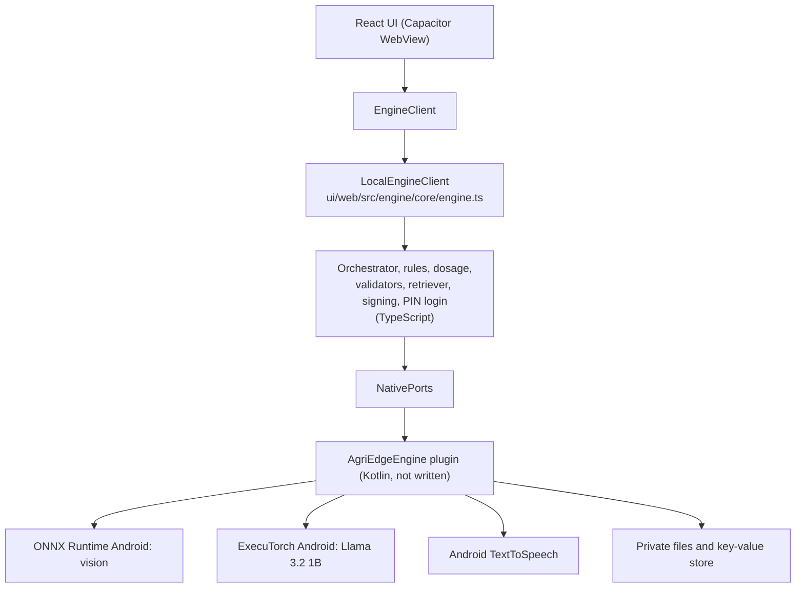

# Android app (APK)

Goal: the whole product runs on the phone with no server and no internet after setup. Vision, language model, rules, dosage, retrieval, login and speech all live inside the app. Status: the TypeScript engine is done and tested; the Kotlin plugin, the Android project and the first build are not done. Nothing has run on a real phone.

## 1. Layers



The web UI talks to an `EngineClient` (`ui/web/src/contracts/types.ts`). On Capacitor, `index.ts` selects `NativeEngineClient`, which is `LocalEngineClient` wired to the plugin. In a browser it selects the HTTP client, which needs the separate edge backend; a browser alone has no on-device engine. Setting `VITE_ENGINE=native` or `http` overrides the choice.

## 2. What is in TypeScript (done)

Under `ui/web/src/engine/core/`:

| File | Role |
|---|---|
| `engine.ts` | `LocalEngineClient`: login, photo analysis, advice, speech, health; fails closed if assets are missing or untrusted |
| `orchestrator.ts` | Same flow as `core/orchestrator.py`: refuse, retake, unsupported, healthy template, retrieve, generate, validate, retry up to 2, fallback, rule check, dosage |
| `validate.ts` | Hand-written validators for `advisory_v3` and `vision_result` (no runtime JSON-schema engine, because the CSP forbids eval); tests compare them with Ajv on the shared schemas |
| `rules.ts` | Banned-product matching after Unicode normalisation |
| `tools.ts` | Dosage table and `calcDosage`; totals come from the table only |
| `prompts.ts`, `templates.ts` | Prompt builder with untrusted-data tags; en, hi and mr templates (generated from the Python text) |
| `severity.ts` | Detection to vision result; severity stays empty without polygons |
| `retriever.ts` | In-memory BM25 over `knowledge/chunks.jsonl`, Devanagari aware |
| `signing.ts` | Ed25519 verification of signed JSON (`@noble/curves`), PEM key parsing |
| `localAuth.ts` | PBKDF2-SHA256 PIN hashing (210,000 iterations), lockout after 5 failures for 30 seconds |
| `types.ts` | Port and data types |

Login on a fresh install creates the profile: the first profile id and PIN entered become the account. After that the PIN is required. The session is kept in memory, so the PIN is asked again after the app restarts. Cases (diagnosis name and time only, never photos) are stored per profile, last 100.

## 3. Native ports the plugin must provide

Plugin name: `AgriEdgeEngine` (registered in `ui/web/src/engine/native.ts`).

| Method | Input | Output |
|---|---|---|
| `detect` | `{ imageBase64 }` | `{ detection: { class_id, label, confidence, bbox?, mask_polygon?, leaf_polygon? } or null }` |
| `generate` | `{ messages: [{role, content}], maxTokens }` | `{ text }` |
| `speak` | `{ text, lang }` | nothing |
| `readAsset` | `{ name }` | `{ base64 }` or `null` when the file is absent |
| `kvGet` | `{ key }` | `{ value }` or `null` |
| `kvSet` | `{ key, value }` | nothing |
| `health` | none | `{ platform, vision_adapter, llm_adapter, audio_adapter, vision_model, llm_model, peak_rss_kb, temp_c }` |

Assets the engine reads through `readAsset`:

- `knowledge/release_ed25519.pub`
- `knowledge/banned_pesticides.json` and `.sig`
- `knowledge/dosage_table.json` and `.sig`
- `knowledge/chunks.jsonl` (optional; empty retrieval if absent)

Vision model, labels, Llama `.pte` and tokenizer are loaded natively by the plugin, not through `readAsset`.

## 4. Kotlin plugin (Stage B, not written)

To implement:

- `detect`: decode the image, resize to 224, run `vision.onnx` with ONNX Runtime Android, softmax if the output is not already probabilities, map the top class through `labels.json`.
- `generate`: build the Llama 3 chat prompt (`<|start_header_id|>` format, one BOS), run ExecuTorch with the `.pte` and `tokenizer.model`, return the text. The TypeScript side extracts and validates the JSON.
- `speak`: Android `TextToSpeech` with the language chosen per call; check that a Hindi or Marathi voice is installed and report if not.
- `readAsset`, `kvGet`, `kvSet`: read from bundled assets and private storage; keep values out of logs.
- First-run model download with hash check (section 6).
- Gradle: arm64-v8a only, R8 minification, ONNX Runtime and ExecuTorch AARs, no cleartext traffic, no backup.

This code cannot be compiled in the authoring sandbox. The first build will come from GitHub Actions or Android Studio and will likely need a round of compile fixes.

## 5. Building the APK

Local (needs Android Studio, JDK 21, Node 22):

```
cd ui\android
npm ci
npm run prepare:android
npm run apk:debug
```

`prepare:android` builds the web app, adds and syncs the Capacitor Android platform (the generated `android\` folder is git-ignored) and runs `scripts\harden-manifest.mjs` (no backup, no cleartext traffic, camera permission, R8 for release).

On GitHub: the `build-apk` workflow builds a debug APK on pushes touching `ui/**`, rejects any source map inside the APK and uploads the APK as an artifact. A tagged release builds a signed release APK if signing secrets are set. The workflow has never run yet.

## 6. Delivering the models

The Llama `.pte` is about 1.0 to 1.2 GB, so it is not packed into the APK and is not in git.

1. Upload `llama32_1b_int4.pte` and `tokenizer.model` to a GitHub Release (files up to about 2 GB each are allowed; confirm on the upload page).
2. The APK, about 60 to 150 MB, holds the app, the small vision model, signed lists and knowledge text.
3. On first launch over Wi-Fi the app downloads the `.pte` and tokenizer, checks the SHA-256 against a value signed into the app, and saves them in private storage. After that it is fully offline.
4. For testing, `adb push` can copy the files to the app's storage folder instead.

## 7. Expected device behaviour (estimates)

| Item | Estimate |
|---|---|
| RAM while Llama is loaded | about 1.5 to 2 GB; 6 GB phones or better |
| Speed | about 5 to 15 tokens per second on a mid-range phone, so a 700-token advisory takes 1 to 2 minutes |
| Retries | a rejected first answer can triple the wait; lowering `maxTokens` or showing progress helps |
| Storage | about 1.3 GB including the model |
| Battery and heat | noticeable during generation |

All unmeasured. Record real numbers in `BENCHMARKS.md`.

## 8. Current limits

- No native plugin yet, so no photo analysis in the APK.
- Advice is tomato-only until the multi-crop work is done.
- Severity needs a segmentation model; without it no dosage total is computed.
- Knowledge text and vetted dosage and banned lists are placeholders or empty.
- Offline Hindi and Marathi speech depends on installed voice data.
- Voice input (speech to text) is not part of the APK yet.
