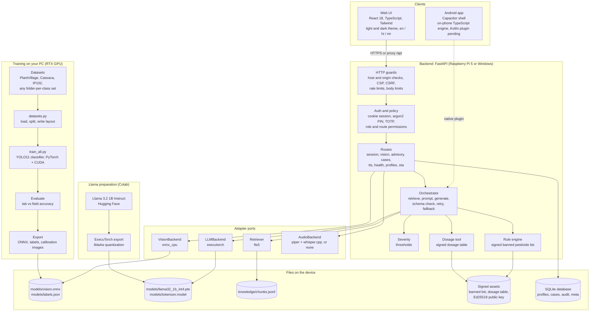
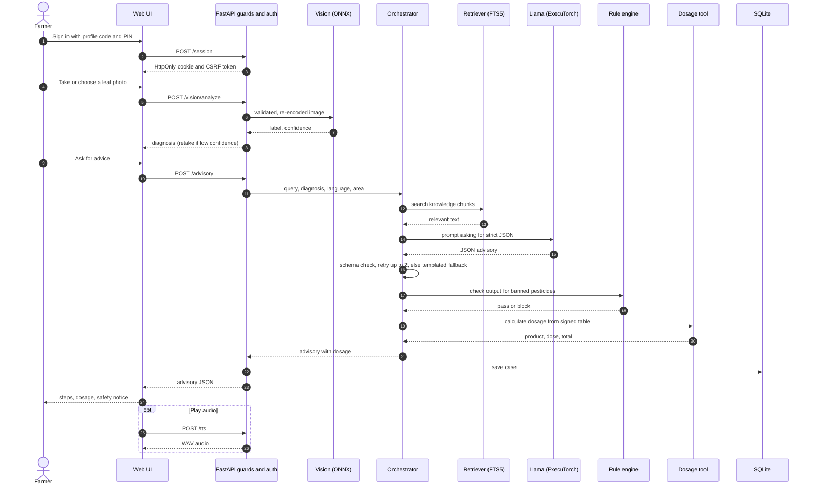
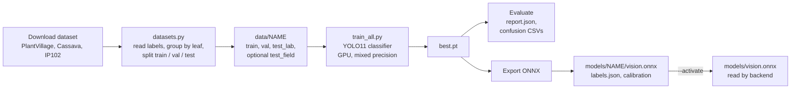
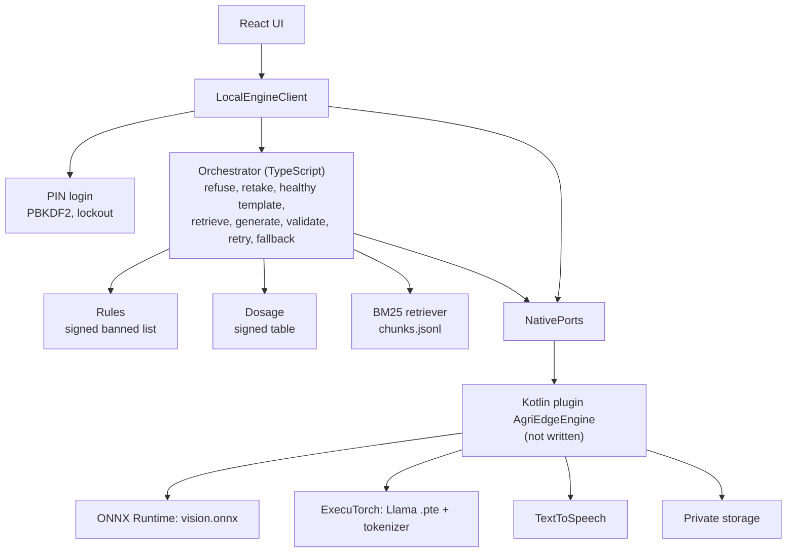

# Architecture

> Edge-server material. This document describes the Raspberry Pi and Python backend track, which lives in the separate AgriEdge edge repository. It is kept here for reference; the mobile app in this repository does not use a server.

The diagrams use Mermaid. GitHub, PyCharm (Markdown preview) and mermaid.live render them.

## System overview

## Request flow: photo to advice

## Training flow

## On-phone engine (APK)

Details of the ports and the build are in `ANDROID.md`. The Python orchestrator and the TypeScript orchestrator implement the same flow; see decision 15 in `DECISIONS.md`.

## Open architecture item: multi-crop advice

Today the crop is fixed to tomato in the advisory schema, the prompt, the retrieval filter and the dosage arguments. The planned design derives crop and disease from the vision label (for example `Potato Late Blight`), validates the crop against the loaded knowledge pack and dosage table, and keeps the same safety rules per crop: no vetted dosage entry means referral to an extension officer. See decision 21.

